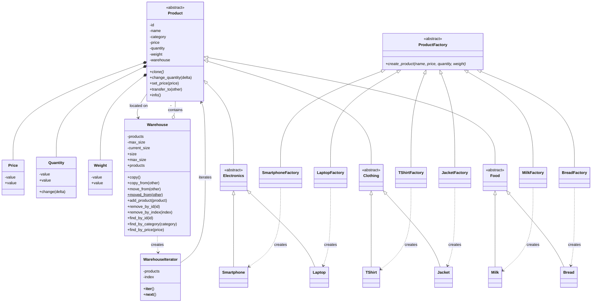
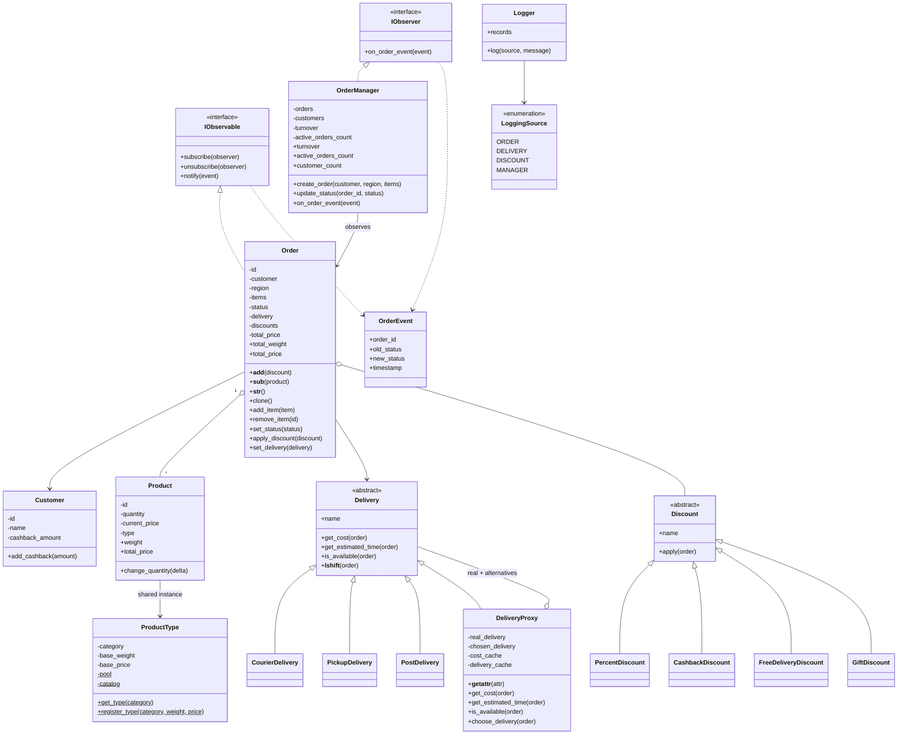

# Лабораторные работы по дисциплине «Объектно-ориентированное программирование»

## Содержание

1. [Работа 1 — Введение в ООП: классы, наследование, контейнеры](#work-1)
2. [Работа 2 — Интерфейсы классов, взаимодействие классов, перегрузка операций](#work-2)

---

## Работа 1 — Введение в ООП: классы, наследование, контейнеры

**Система:** управление складом и каталогом товаров.

- Иерархия товаров: `Product` → `Electronics` / `Clothing` / `Food` → конкретные товары
  (`Smartphone`, `Laptop`, `TShirt`, `Jacket`, `Milk`, `Bread`).
- Классы-атрибуты `Price`, `Quantity`, `Weight` с проверкой корректности значений.
- `Warehouse` — контейнер с ограничением вместимости; `WarehouseIterator` — обход товаров.
- Паттерны: **Фабричный метод / Абстрактная фабрика** (`ProductFactory` + 6 конкретных фабрик),
  **Итератор** (`WarehouseIterator`).
- Глубокое копирование (`copy` / `__deepcopy__`) и перемещение (`move_from`) склада.
- Поиск по ID / категории / цене, удаление по ID / индексу, перенос товара между складами.
- 5 демонстрационных сценариев.

### UML-диаграмма классов

**Модули:** `products.py`, `warehouse.py`, `product_factory.py`, `scenarios.py`, `main.py`.

---

## Работа 2 — Интерфейсы классов, взаимодействие классов, перегрузка операций

**Система:** управление заказами, способами доставки и акциями.

- `OrderManager` — создание заказов, отслеживание статусов, лимиты активных заказов,
  учёт оборота и количества клиентов.
- 3 способа доставки: `CourierDelivery`, `PickupDelivery`, `PostDelivery` — с расчётом
  стоимости, времени и проверкой доступности по весу и региону.
- 4 акции: `PercentDiscount`, `CashbackDiscount`, `FreeDeliveryDiscount`, `GiftDiscount`.
- Паттерны:
  - **Наблюдатель** — `IObserver` / `IObservable` / `OrderEvent`; `OrderManager` обновляет
    статистику при смене статуса заказа;
  - **Прокси** — `DeliveryProxy`: делегирование через `__getattr__`, проверка доступности,
    кеширование стоимости, автоматический fallback на альтернативную доставку;
  - **Стратегия** — интерфейсы `Discount` и `Delivery` с набором конкретных стратегий;
  - **Легковес** — `ProductType` с общим пулом и каталогом `ProductCategory`.
- Идиоматичные операции взаимодействия: `order + discount` (`__add__`), `order - product`
  (`__sub__`), `delivery << order` (`__lshift__`), вывод `str(order)`; для неподдерживаемых
  типов возвращается `NotImplemented`, деловые операции доступны и именованными методами.
- Явное клонирование изменяемого состояния: `Product.clone()` и `Order.clone()`
  (подписчики не копируются).
- Python-особенности: `abc.ABC` + `@abstractmethod`, snake_case, свойства `@property`
  вместо `get_*`, точка входа `main()` + `if __name__ == "__main__"`.
- Логирование всех операций с источниками `ORDER`, `DELIVERY`, `DISCOUNT`, `MANAGER`.
- 5 демонстрационных сценариев.

### UML-диаграмма классов

**Модули:** `manager/`, `order/`, `product/`, `delivery/`, `discount/`, `observer/`,
`customer/`, `logging/`, `scenarios.py`, `main.py`.
