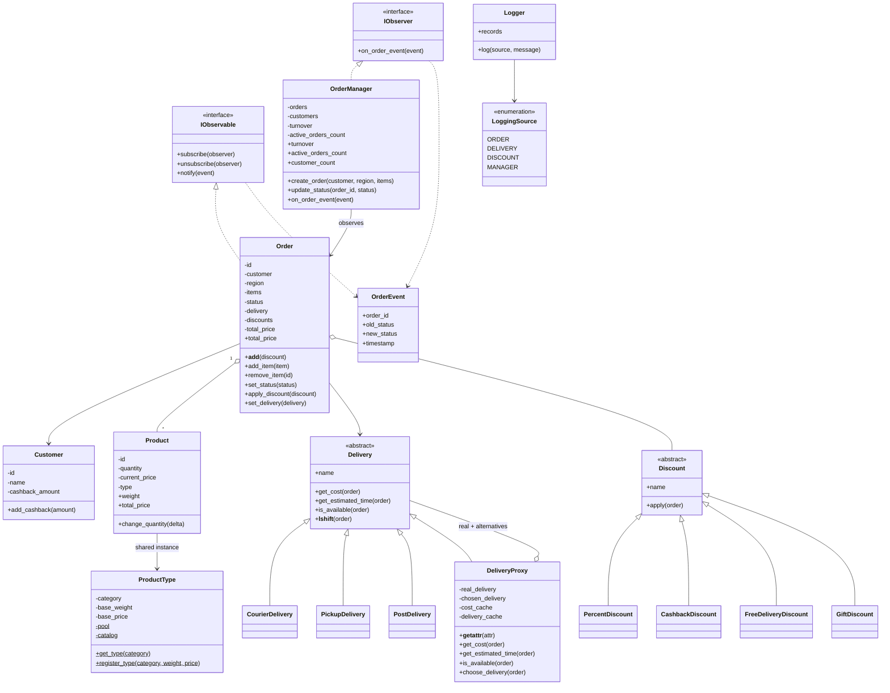

# Отчёт по лабораторной работе 2

## «Интерфейсы классов, взаимодействие классов, перегрузка операций»

## 1. Цель работы

Реализовать систему управления заказами, способами доставки и акциями. Использовать паттерны «Наблюдатель», «Прокси», «Стратегия», а также перегрузку операторов для взаимодействия классов.

## 2. Постановка задачи

Разработать класс `OrderManager`, который отвечает за создание заказов, учёт, отслеживание статусов и ограничения (максимальное количество активных заказов, лимит нагрузки, оборот, количество клиентов). Дополнительно реализовать:

- **способы доставки** (минимум 3) с разными характеристиками (стоимость, скорость, ограничения по весу и региону);
- **акции и скидки** (минимум 4) с разными правилами расчёта (процент, cashback, бесплатная доставка, подарок);
- **взаимодействие через перегрузку операторов** (`order + discount`, `delivery << order`);
- **паттерны** «Наблюдатель», «Прокси», «Стратегия», «Легковес».

---

## 3. Архитектура системы

### 3.1. UML-диаграмма классов



### 3.2. Текстовое описание взаимосвязей

- `OrderManager` реализует `IObserver` и подписывается на каждый созданный `Order` (который реализует `IObservable`). При смене статуса `Order` рассылает `OrderEvent` всем наблюдателям, и менеджер обновляет оборот и счётчик активных заказов.
- `Order` агрегирует `Customer`, список `Product`, необязательный `Delivery` и список `Discount`.
- `Product` хранит ссылку на общий `ProductType` (легковес) и собственные `Quantity` и `CurrentPrice`.
- `ProductType` содержит статический пул и каталог категорий; экземпляры выдаются через `get_type`.
- `Delivery` — абстрактный интерфейс; `CourierDelivery`, `PickupDelivery`, `PostDelivery` — конкретные стратегии; `DeliveryProxy` оборачивает реальную доставку, проверяет доступность, кеширует стоимость и логирует вызовы, при необходимости подбирая альтернативу.
- `Discount` — абстрактный интерфейс; `PercentDiscount`, `CashbackDiscount`, `FreeDeliveryDiscount`, `GiftDiscount` — конкретные стратегии.
- `Logger` (синглтон) централизованно пишет логи с источником `LoggingSource` (`ORDER`, `DELIVERY`, `DISCOUNT`, `MANAGER`).

### 3.3. Структура проекта

Разделение выполнено по логической близости классов: для Python модуль является единицей организации кода.

```
.
├── main.py                     # точка входа
├── scenarios.py                # демонстрационные сценарии 1–5
├── customer/
│   └── customer.py             # Customer
├── product/
│   ├── product.py              # Quantity, CurrentPrice, Product
│   ├── product_type.py         # BaseWeight, BasePrice, ProductType (пул)
│   ├── product_category.py     # ProductCategory (единый каталог категорий)
│   └── catalog.py              # регистрация категорий в пуле
├── order/
│   ├── order.py                # Order
│   └── order_status.py         # OrderStatus + переходы
├── delivery/
│   ├── delivery.py             # интерфейс Delivery
│   ├── delivery_region.py      # DeliveryRegion
│   ├── courier_delivery.py     # CourierDelivery
│   ├── pickup_delivery.py      # PickupDelivery
│   ├── post_delivery.py        # PostDelivery
│   └── delivery_proxy.py       # DeliveryProxy
├── discount/
│   ├── discount.py             # интерфейс Discount
│   ├── percent_discount.py     # PercentDiscount
│   ├── cashback_discount.py    # CashbackDiscount
│   ├── free_delivery_discount.py
│   └── gift_discount.py
├── observer/
│   ├── i_observer.py           # IObserver
│   ├── i_observable.py         # IObservable
│   └── order_event.py          # OrderEvent
├── manager/
│   └── order_manager.py        # OrderManager
└── logging/
    ├── logger.py               # Logger (синглтон)
    └── logging_source.py       # LoggingSource
```

---

## 4. Ключевые классы и интерфейсы

### 4.1. `OrderManager`

Отвечает за создание заказов и учёт статистики.

- `create_order(customer, region, items) -> Order` — создаёт заказ, проверяет лимиты и пустой список товаров, подписывается на события заказа.
- `update_status(order_id, status)` — делегирует смену статуса заказу.
- `on_order_event(event)` — при переходе в `Paid` увеличивает оборот, при `Paid -> Cancelled` уменьшает, при переходе в неактивный статус снимает заказ с учёта активных.
- Свойства: `turnover`, `active_orders_count`, `customer_count`.
- Ограничения: `customer_max_active_orders` (по умолчанию 5) и `max_active_orders` (по умолчанию 100).

### 4.2. `Order`

- Поля: `id`, `customer`, `region`, `items`, `status`, `delivery`, `discounts`, `total_price`.
- Статусы: `Pending`, `Paid`, `Shipped`, `Delivered`, `Cancelled`; переходы заданы в `OrderStatus`.
- Методы: `add_item`, `remove_item`, `get_items`, `set_status`, `set_delivery`, `apply_discount`.
- Перегрузки: `__add__` (`order + discount`), `__lshift__` (`delivery << order`), `__str__` (вывод заказа).
- Цена пересчитывается динамически: сумма товаров + доставка − накопленная скидка.

### 4.3. `Product` и `ProductType` (Легковес)

- `ProductCategory` — enum со всеми категориями (название, базовый вес, базовая цена); единый источник правды.
- `ProductType` — неизменяемый тип товара с пулом `_pool` и каталогом `_catalog`; `get_type(category)` возвращает общий экземпляр.
- `Product` хранит `id`, `Quantity`, `CurrentPrice` и ссылку на `ProductType`; `Product.from_category(...)` — удобная типобезопасная фабрика (цена по умолчанию берётся из каталога).

### 4.4. Доставка

| Способ | Стоимость | Время | Ограничения |
|---|---|---|---|
| `CourierDelivery` | 500 + 20 × max(0, вес − 10) | 1–2 дня | до 20 кг; 6 городов |
| `PickupDelivery` | 0 | 1–3 дня | без ограничений по весу; 6 городов |
| `PostDelivery` | 200 + 30 × max(0, вес − 5) | 5–10 дней | до 10 кг; все регионы |

Все классы реализуют интерфейс `Delivery` с методами `get_cost`, `get_estimated_time`, `is_available`.

### 4.5. Скидки

| Класс | Правило |
|---|---|
| `PercentDiscount` | уменьшает сумму заказа на заданный процент (по умолчанию 10%) |
| `CashbackDiscount` | начисляет процент (по умолчанию 5%) на бонусный счёт клиента, не меняя сумму заказа |
| `FreeDeliveryDiscount` | обнуляет стоимость доставки |
| `GiftDiscount` | добавляет бесплатный товар (цена 0) |

Все классы реализуют интерфейс `Discount` с методом `apply(order)`.

---

## 5. Паттерны проектирования

### 5.1. Стратегия (Strategy)

Интерфейсы стратегий — `Discount` (в терминах задания `DiscountStrategy`) и `Delivery` (`DeliveryStrategy`). Конкретные алгоритмы вынесены в отдельные классы, поэтому новые скидки и способы доставки добавляются без изменения `Order` и `OrderManager`.

### 5.2. Наблюдатель (Observer)

- `IObserver` — метод `on_order_event(event)`.
- `IObservable` — `subscribe`, `unsubscribe`, `notify`.
- `OrderEvent` — `order_id`, `old_status`, `new_status`, `timestamp`.
- `Order` при `set_status` формирует событие и уведомляет подписчиков; `OrderManager` подписывается при создании заказа и обновляет оборот/счётчик активных заказов.

### 5.3. Прокси (Proxy)

`DeliveryProxy` наследует `Delivery` и:

- делегирует вызовы через `__getattr__`;
- проверяет доступность реального способа (вес + регион) и при недоступности автоматически выбирает альтернативу с минимальной стоимостью;
- кеширует результат расчёта стоимости (`_cost_cache`) и выбранный способ (`_delivery_cache`);
- логирует проверки и расчёты.

### 5.4. Легковес (Flyweight)

`ProductType` хранит общее (внутреннее) состояние — категорию, базовый вес и базовую цену. Экземпляры типов создаются один раз и переиспользуются всеми `Product` через статический пул `_pool`. Каталог категорий задаётся один раз через `ProductCategory` и регистрируется при создании менеджера.

---

## 6. Перегрузка операторов

В Python перегрузка реализована через магические методы.

### 6.1. `order + discount` — `Order.__add__`

```python
def __add__(self, discount: Discount) -> "Order":
    self.apply_discount(discount)
    return self
```

Применяет скидку и возвращает заказ с обновлённой суммой:
```python
order = order + PercentDiscount("10")
```

### 6.2. `delivery << order` — `Delivery.__lshift__`

```python
def __lshift__(self, order: Order):
    order.set_delivery(self)
    Logger().log(LoggingSource.DELIVERY, f"Delivery «{self.name}» assigned to order #{order.id}")
    return order
```

Назначает способ доставки заказу (аналог `order.set_delivery(delivery)`):
```python
CourierDelivery() << order
```

### 6.3. Вывод заказа — `Order.__str__`

Формирует читаемое представление заказа (аналог `std::ostream& operator<<` в C++); используется при `print(order)`.

Итого задействованы **три** различные операции: `+`, `<<` и вывод.

---

## 7. Логирование

Логирование реализовано через `Logger` (синглтон) — аналог `LoggingProxy` из лабораторной работы №5. Все значимые операции пишутся с источником `LoggingSource`:

- `ORDER` — добавление/удаление товара, смена статуса, применение скидки, назначение доставки;
- `DELIVERY` — назначение доставки, проверка доступности, расчёт стоимости, попадание в кеш;
- `DISCOUNT` — расчёт скидки, начисление кэшбэка, обнуление доставки, добавление подарка;
- `MANAGER` — создание заказа, отказ по лимиту, обновление оборота/активных заказов.

Логи выводятся зелёным цветом, чтобы визуально отличать их от обычного текста сценариев.

---

## 8. Результаты сценариев

### Сценарий 1. Создание заказа, добавление товаров, процентная скидка

- Кружка ×3 = 900 RUB.
- + Powerbank ×1 → 2700 RUB.
- + Книга ×2 → 3800 RUB.
- `order + PercentDiscount("10")` → **3420 RUB** (скидка 380 RUB).

### Сценарий 2. Выбор доставки и проверка доступности через `DeliveryProxy`

- Заказ 0.25 кг (Москва): курьер доступен, стоимость **500 RUB**, время **1–2 дня**; `proxy << order` назначает доставку.
- Заказ 25 кг (Москва): курьер недоступен (лимит 20 кг), прокси автоматически выбрал **самовывоз** — стоимость **0 RUB**, время **1–3 дня**.

### Сценарий 3. Смена статусов и уведомление `OrderManager`

- До оплаты: оборот 0 RUB, активных заказов 1.
- `Pending -> Paid`: оборот **600 RUB**.
- `Paid -> Shipped -> Delivered`: оборот остаётся 600 RUB, активных заказов **0**.

### Сценарий 4. Несколько скидок на одном заказе

- Кружка ×2 + книга ×1 = 1150 RUB; + курьер 500 → **1650 RUB**.
- `+10%` → **1485 RUB**.
- `+5% cashback` → сумма не меняется (**1485 RUB**), на бонусный счёт начислено 74.25 RUB.
- `+ бесплатная доставка` → **985 RUB**.
- `+ подарок` (бесплатный товар) → **985 RUB**.

### Сценарий 5. Отмена заказа, лимит и статистика

- Лимит 2 активных заказа на клиента; третий заказ отклонён с сообщением о лимите.
- Отмена заказа #7 → активных заказов **1**.
- После освобождения лимита создан заказ #8 → активных заказов **2**.
- Оплата заказа #6 (ноутбук) → оборот **55000 RUB**, активных 2, клиентов 1.

---

## 9. Выводы

В ходе работы реализована система управления заказами, доставкой и акциями на Python. Все требования выполнены:

- `OrderManager` создаёт заказы, отслеживает статусы, соблюдает лимиты, ведёт учёт оборота и клиентов;
- реализованы 3 способа доставки с общим интерфейсом, расчётом стоимости и проверкой доступности по весу и региону;
- реализованы 4 акции с общим интерфейсом;
- продемонстрированы 3 перегрузки операторов (`+`, `<<`, вывод);
- применены паттерны «Стратегия», «Наблюдатель», «Прокси», «Легковес»;
- все операции логируются с разделением по источникам;
- подготовлены и успешно выполнены 5 демонстрационных сценариев.

Использование паттернов позволило отделить алгоритмы скидок и доставки от заказа, организовать слабую связанность через Observer и добавить проверку доступности, кеширование и fallback без изменения основного кода.